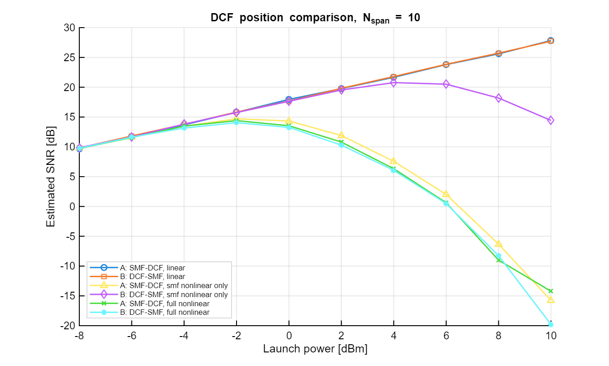
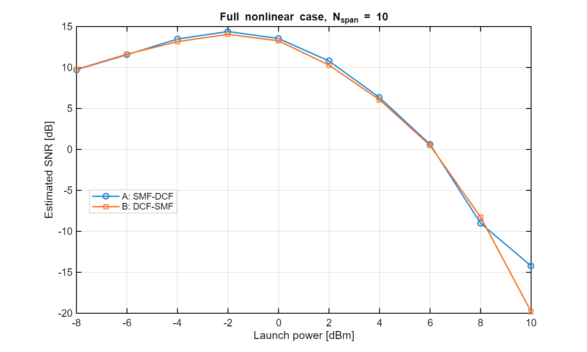
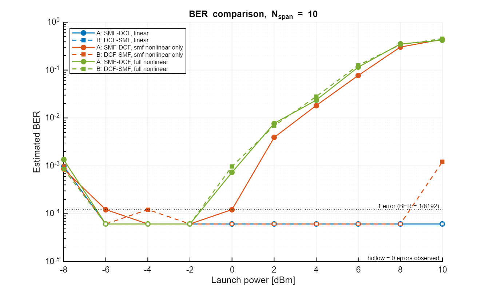
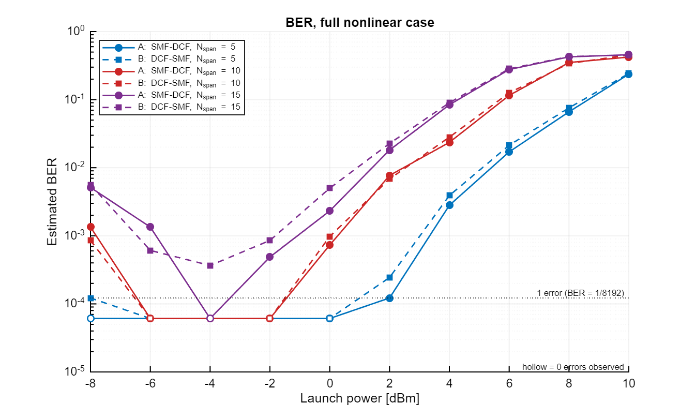
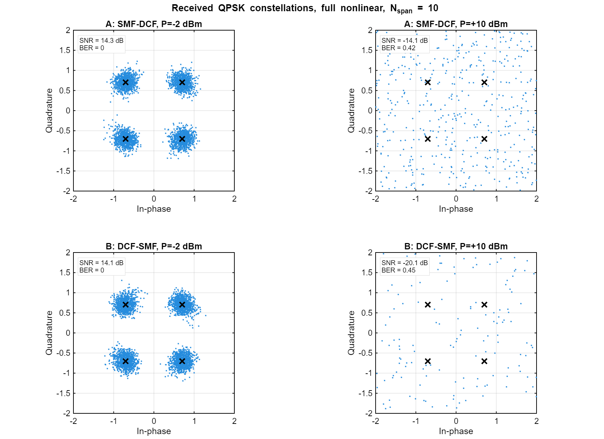

# In-line DCF Position in a Dispersion-Managed QPSK Optical Link

MATLAB simulation that studies how the **position of the dispersion-compensating fiber (DCF)** inside each span changes the performance of a multi-span QPSK optical link when Kerr nonlinearity and group-velocity dispersion (GVD) interact.

The simulation is built on the open-source **[Optilux](https://optilux.sourceforge.io)** toolbox (see [References](#references)).

---

## What is simulated

Two span configurations are compared. Each span has an EDFA after it:

| Configuration | Span order |
|---|---|
| **A: SMF → DCF** | transmission fiber first, then in-line DCF, then amplifier |
| **B: DCF → SMF** | in-line DCF first, then transmission fiber, then amplifier |

The in-line DCF compensates **80 %** of the dispersion of each span. A final **post-compensating DCF** after the last span removes the remaining accumulated dispersion at 1550 nm. Both configurations therefore have the same total fiber length, dispersion compensation and span loss, so any difference between them comes from nonlinear propagation.

Three propagation cases separate the contribution of each fiber:

| Case | Kerr nonlinearity on in… |
|---|---|
| `linear` | no fiber (n₂ = 0 everywhere) |
| `smf nonlinear only` | SMF only |
| `full nonlinear` | SMF, in-line DCF and post-DCF |

### Main parameters

| Parameter | SMF | DCF |
|---|---|---|
| Length per span | 100 km | 13.6 km (80 % in-line compensation) |
| Dispersion | 17 ps/(nm·km) | −100 ps/(nm·km) |
| Attenuation | 0.2 dB/km | 0.6 dB/km |
| Effective area | 80 µm² | 20 µm² |
| Nonlinear coefficient γ | ≈ 1.27 W⁻¹km⁻¹ | ≈ 5.07 W⁻¹km⁻¹ |

- Modulation: single-polarization QPSK, 10 Gbaud, root-raised-cosine shaping (roll-off 0.01)
- 4096 symbols, 16 samples/symbol, fixed random seed (results are repeatable)
- EDFA: gain = span loss (28.16 dB), noise figure 6 dB
- Launch power sweep: −8 dBm to +10 dBm in 2 dB steps
- Number of spans: 5, 10, 15
- Receiver: coherent, data-aided synchronization, no optical filter limitation

---

## Files

| File | Purpose |
|---|---|
| `dcf_position_qpsk_simulation.m` | Main simulation: runs every sweep and saves the SNR plots, constellations and a CSV summary |
| `ber_vs_launch_power_logscale.m` | Plots BER vs launch power on a logarithmic axis. It reuses the results of the main script and runs it automatically if no results exist yet. |
| `figures/` | Example output figures |
| `LICENSE` | GNU GPL v3 |

---

## How to run

**Requirements:** MATLAB R2019b or newer, and the Optilux toolbox.

1. Download Optilux from **https://optilux.sourceforge.io** and unzip it anywhere on your computer.
2. Open `dcf_position_qpsk_simulation.m` and set line 16 to your Optilux folder:
   ```matlab
   optiluxPath = 'C:\path\to\optilux';
   ```
3. Run `ber_vs_launch_power_logscale.m`.
   - The first time, it runs the full simulation. This takes a while: 180 sweep points plus the constellation plots.
   - The results are saved to `outputs/dcf_position_qpsk_results.mat`, so later runs only re-plot and take a few seconds.

All figures and the CSV summary are written to an `outputs/` folder next to the scripts.

---

## Results (examples)

**SNR vs launch power, N_span = 10** (all cases and both configurations)



**Full nonlinear case, A vs B, N_span = 10**



**BER vs launch power, N_span = 10** (logarithmic axis)



**BER vs launch power, full nonlinear case, N_span = 5, 10, 15** (A solid, B dashed)



**Received constellations, full nonlinear case, N_span = 10**



### Optimum operating points (full nonlinear case)

| N_span | Configuration | Best launch power | Best SNR |
|---|---|---|---|
| 5 | A: SMF → DCF | 0 dBm | 18.30 dB |
| 5 | B: DCF → SMF | −2 dBm | 17.85 dB |
| 10 | A: SMF → DCF | −2 dBm | 14.40 dB |
| 10 | B: DCF → SMF | −2 dBm | 14.06 dB |
| 15 | A: SMF → DCF | −2 dBm | 11.85 dB |
| 15 | B: DCF → SMF | −2 dBm | 11.48 dB |

### Main observations

- **Linear regime:** A and B behave the same. SNR grows 1 dB per dB of launch power and drops about 3 dB each time the number of spans doubles, as expected for ASE-limited transmission. The simulated SNR at −8 dBm agrees with the analytical ASE value within 0.1 dB.
- **Nonlinear regime:** around the optimum launch power, **SMF → DCF is about 0.3–0.5 dB better**. In DCF → SMF the signal enters the DCF at full power right after the amplifier. The DCF has a small effective area and therefore a γ about 4× higher, so it adds more nonlinear distortion.
- **More spans:** the optimum power moves lower and the peak SNR drops. From 5 to 10 spans it falls by 3.9 dB, and from 5 to 15 spans by 6.45 dB. This closely follows the N^(−4/3) scaling expected for coherent nonlinear accumulation in dispersion-managed links.
- **At extreme powers** the ranking between A and B can flip, so no configuration is better everywhere.

### Notes on accuracy

- BER is counted directly over **8192 bits** per point, so the smallest measurable non-zero BER is 1/8192 ≈ 1.2·10⁻⁴. Values below about 10⁻³ come from only a few errors and are noisy. In the log plots, hollow markers mean *zero errors observed*, not a true BER of zero. The **SNR curves are the more reliable measure.**
- Each point uses one random realization. The SSFM step is 20 km in the SMF and 5 km in the DCF. A step-size convergence check is included in the main script (`runStepConvergence = true`).
- Not modeled: PMD, WDM, Raman scattering and dual-polarization effects.

---

## References

- **Optilux:** P. Serena, M. Bertolini and A. Vannucci, "OptiLuX Toolbox", Department of Engineering and Architecture, University of Parma, Italy. Open-source Matlab/Octave toolbox, GNU GPL v3.
  Website: **https://optilux.sourceforge.io** · Project page: https://sourceforge.net/projects/optilux/
  All the optical/communication functions used here come from Optilux: `fiber`, `ampliflat`, `lasersource`, `iqmodulator`, `digitalmod`, `datapattern`, `rxfrontend`, `rxdsp`, `samp2pat`, `samp2snr`, `pat2samp` and `inigstate`. Optilux is not included in this repository. Please download it from the official website.
- G. P. Agrawal, *Fiber-Optic Communication Systems*, 5th ed., Wiley, 2021.
- A. D. Ellis, M. E. McCarthy, M. A. Z. Al Khateeb, M. Sorokina and N. J. Doran, "Performance limits in optical communications due to fiber nonlinearity," *Advances in Optics and Photonics*, vol. 9, no. 3, pp. 429–503, 2017.

---

## License

This project is released under the **GNU General Public License v3.0**, the same license as Optilux (see `LICENSE`).

## Author

Maher Ghaly, Communication Engineering, University of Parma
